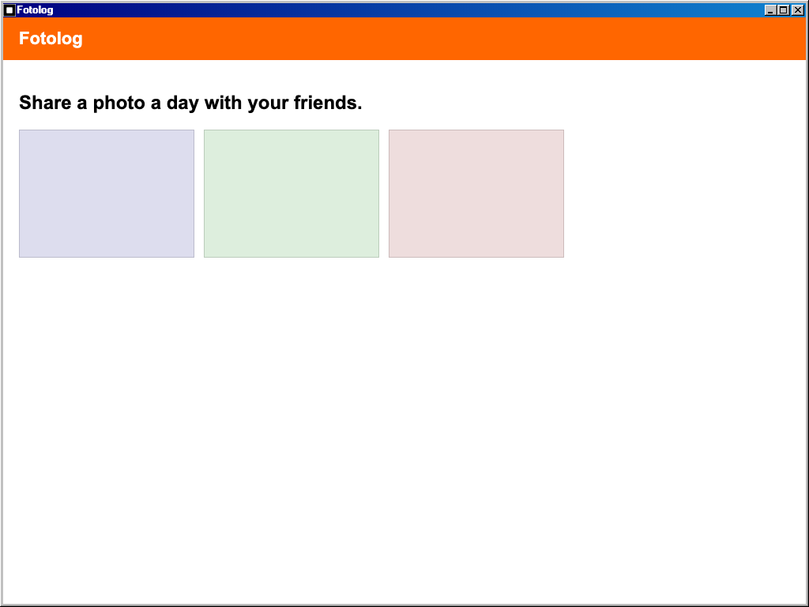

# Fotolog

## Purpose

The **Fotolog** app opens the Fotolog photo-sharing page of the running MSN web app (the `MSN-working-clone` project) inside a Windows 98 window. No Fotolog code lives in this repo; the window only frames the live app at its `/fotolog` route.

## Key Features

- **Desktop and Start menu entry**: A "Fotolog" shortcut on the desktop (restored for returning users like the other defaults) and an entry directly under Start > Programs.
- **Content-sized window**: Opens as a 1024x768 window suited to the wide Fotolog page; it can be resized and maximized like any other app.
- **Single instance**: Launching it again focuses (or restores) the existing window instead of opening a second one or reloading the frame.
- **Configurable URL**: The framed URL is the build-time variable `VITE_MSN_URL` plus `/fotolog`, defaulting to `/fotolog` on the same origin.
- **Sign-in required**: Fotolog is a private MSN route; signed-out users get the MSN login page inside the window. After signing in, MSN navigates to its home page, so close and reopen the window to reach Fotolog.

## How to Use

1. Double-click **Fotolog** on the desktop (or open Start > Programs > Fotolog).
2. Sign in inside the window if prompted, then reopen the window to reach Fotolog.
3. Resize or maximize the window for a larger view.

## Development

Run the MSN frontend and point this app at it (see [MSN Messenger](../msn-messenger/README.md) for details):

```bash
# in MSN-working-clone (frontend only)
npm run dev:local

# in win98-web
VITE_MSN_URL=http://localhost:5179 bun run dev
```

Without `VITE_MSN_URL` the frame loads `/fotolog` of the current origin, which only resolves to MSN in the Docker deployment.

## Technologies Used

- **IFrameApplication**: Managed as a singleton system application.
- **`msn-frame.js`**: Shared helper (`src/shared/utils/msn-frame.js`) that builds the MSN-family `$Window` + iframe, also used by MSN Messenger.
- **`import.meta.env.VITE_MSN_URL`**: Build-time URL override.

## Screenshot


