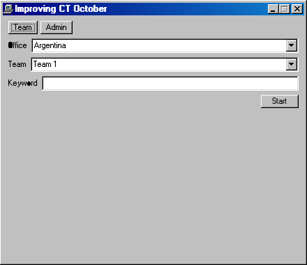

# Improving CT October

## Purpose

The **Improving CT October** window starts a timed office session for the Y2K game. A crew picks Argentina or Chile, picks a team, and types that team's keyword. An admin for that office manages the teams and reads the board.

## Key Features

- **Desktop and Start menu entry**: An "Improving CT October" shortcut on the desktop, restored for returning users, and an entry directly under Start > Programs.
- **Crew**: Office, team, and keyword. Enter and Start both begin the session. A wrong keyword stays editable. A second start keeps the original clock. After the patch is accepted, Start a new game returns to the team form on this computer. The finished team's result stays on the server.
- **Countdown**: A retro timer on the right side of the desktop counts down from 60:00. At 00:00 it says Game over, and the window says the team can still enter the patch. When the server accepts the code, the window says whether the team made it inside the hour, the timer plays a short sign-off, and then the timer leaves. A new tab does not show it until that tab starts.
- **Admin**: The office password opens the patch code field, the team list, a Refresh board, the podium, Restart on a running or finished team, and Reset all. Each office has its own patch code: the admin can view and save it at the top of the Admin view, and saving a new code retires the default immediately. Restart clears only that team's time. Reset all warns first when someone is still playing.

## How to Use

1. Double-click **Improving CT October** on the desktop, or open Start > Programs > Improving CT October.
2. Crew: pick the office and team, type the keyword, and press Start.
3. Admin: choose Admin, pick the office, and enter that office's password.

The patch code is still entered in Y2K Patch. This window only starts and manages the session.

## Stations

While a team's session is running, the station engine (`stations/engine.js`) applies that office's stations and removes them when the session stops running (patch accepted, admin restart or reset, Start a new game). A station is a module with `{ id, apply(ctx), remove(ctx, manifest) }`; `ctx` is `{ fs, office }`. `apply` must be idempotent and returns a JSON manifest of what it created; `remove` deletes exactly that. Applied stations are recorded in `/C:/.ct_stations.json` and leftovers are cleaned at boot on a tab with no team session. To add one, create `stations/<name>.js` and add `{ id, load: () => import("./<name>.js") }` to its office list in `stations/registry.js`.

- Argentina: `stations/argentina-recycle.js` hides a clue image in the Recycle Bin (`IMG_0001.png`, restorable to `C:\My Documents`), and `stations/argentina-throwback.js` creates `C:\THROWBACK` with `MEMORY.TXT`, `ERROR.LOG` and `PLANO.TXT`, shows a short `HELP` screen in MS-DOS Prompt, puts the full help file `HELP_PANTALLA.TXT` on the desktop, and starts new prompts at `C:\`. `stations/argentina-signals.js` also drops `Communication System.txt` (`SIGNALS.TXT`, a Morse reference) on the desktop. Both offices also get `stations/minesweeper.js`, which locks Minesweeper to a fixed board (Argentina 9x9/10 → `Codigo: 1`; Chile 6x6/4 → `SECTOR DESBLOQUEADO: BODEGA`), skips the high-score dialog, and shows taunts from the third consecutive loss.
- Chile: `stations/chile-throwback.js` creates `C:\THROWBACK` with `PLANO.TXT`, `MEMORY.TXT` and `ERROR.LOG`, and overrides the MS-DOS Prompt `HELP` output while the session runs. `stations/chile-morse.js` also writes `MORSE.TXT` (Morse table and three transmissions) in `C:\My Documents`; `stations/chile-recycle.js` fills the Recycle Bin with four dated decoys (`VACACIONES_1998.BMP`, `TAREA_FINAL_FINAL.DOC`, `NO_ABRIR.TXT` and the real `BACKUP_2359.TXT`, all restorable to `C:\My Documents`); `stations/chile-y2k.js` writes the Y2K puzzle (`SYSTEM\ERROR.LOG` + `MEMORY.TXT`) under `C:\My Documents`; `stations/chile-paint.js` drops `PUERTA.BMP` (a white image whose hidden message appears after a Fill With Color in Paint) in `C:\My Documents` and makes Paint's File > Open preselect the `24-bit Bitmap` type while the session runs. The Recycle Bin plumbing is shared in `stations/lib/recycle.js`.

## Development

```bash
VITE_CT_API_URL=http://127.0.0.1:3001 bun run dev
```

Leave `VITE_CT_API_URL` unset when the desktop is served from the same origin as the API.

## Screenshot


