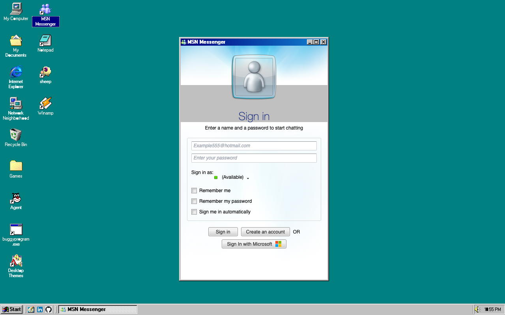

# MSN Messenger

## Purpose

The **MSN Messenger** app opens the running Windows Live Messenger web app (the `MSN-working-clone` project) inside a Windows 98 window, so Messenger feels installed in the OS. No Messenger code lives in this repo; the window only frames the live app.

## Key Features

- **Desktop and Start menu entry**: A "MSN Messenger" shortcut on the desktop (restored for returning users like the other defaults) and an entry directly under Start > Programs.
- **Compact Messenger-style window**: Opens as a portrait, contact-list-sized window (529x796), not maximized; it can be resized and maximized like any other app.
- **Single instance**: Launching it again focuses the existing window instead of opening a second one.
- **Configurable URL**: The framed URL is the build-time variable `VITE_MSN_URL`, defaulting to `/` (MSN is served at the root of the same domain in the Docker deployment).
- **Session preserved in storage**: In the same-origin deployment the frame shares `localStorage` with the top-level MSN page, so the Messenger session is the same one used by MSN opened in another tab (signing out in one signs out the other).
- **Inactivity awareness**: Typing or moving inside the frame resets the desktop screensaver timer (same-origin only; a cross-origin frame logs a warning and keeps working).

## How to Use

**Opening other MSN apps**: the app switcher buttons MSN shows on its pages (`nav.app-shortcuts` with `a.app-shortcuts__link` links to `/`, `/winamp` and `/fotolog`) open the matching Win98 window instead of navigating this frame, when the frame is same-origin with Win98. This depends on the `app-shortcuts__link` class and those hrefs; if MSN changes them, the buttons simply navigate inside the frame as before. On a cross-origin frame (for example `VITE_MSN_URL` pointing at another port) the interception cannot attach and the buttons navigate inside the frame.

1. Double-click **MSN Messenger** on the desktop (or open Start > Programs > MSN Messenger).
2. Sign in inside the window as you would on the MSN site.
3. Resize or maximize the window if you want a larger chat view.

## Development

Run the MSN frontend and point this app at it:

```bash
# in MSN-working-clone (frontend only, no database needed for the login page)
npm run dev:local

# in win98-web
VITE_MSN_URL=http://localhost:5179 bun run dev
```

Without `VITE_MSN_URL` the frame loads `/` of the current origin, which only resolves to MSN in the Docker deployment.

## Technologies Used

- **IFrameApplication**: Managed as a singleton system application.
- **`import.meta.env.VITE_MSN_URL`**: Build-time URL override (Vite `VITE_`-prefixed env var).
- **MSN-working-clone**: The framed app itself; served at `/` on the same domain in production.

## Screenshot


