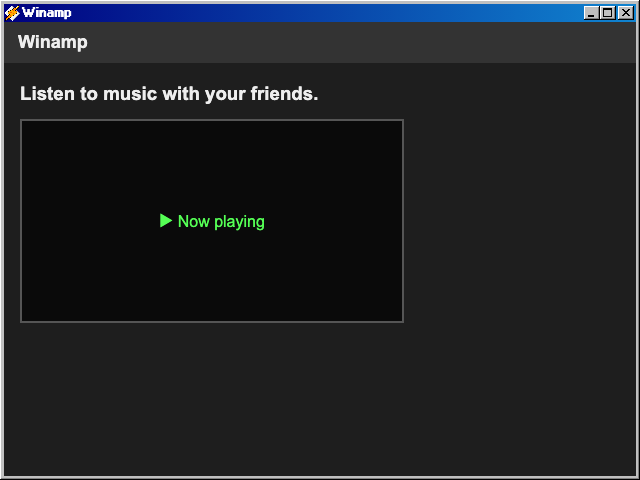

# Winamp

## Purpose

The **Winamp** app opens the Winamp page of the running MSN web app (the `MSN-working-clone` project) inside a Windows 98 window. No Winamp code lives in this repo; the window only frames the live app at its `/winamp` route.

The classic Webamp-based player is archived in place under the `webamp` app id — see [its README](../webamp/README.md) for details.

## Key Features

- **Desktop and Start menu entry**: A "Winamp" shortcut on the desktop and an entry directly under Start > Programs. Existing users' old "Winamp" shortcuts are repointed to this app once, preserving the icon's position on the desktop.
- **Compact window**: Opens as a 640x480 window; it can be resized and maximized like any other app. Note: the MSN Winamp page switches to its stacked mobile layout below ~760px wide, so at the default size it scrolls vertically.
- **Single instance**: Launching it again focuses (or restores) the existing window instead of opening a second one or reloading the frame.
- **Configurable URL**: The framed URL is the build-time variable `VITE_MSN_URL` plus `/winamp`, defaulting to `/winamp` on the same origin.
- **Sign-in required**: Winamp is a private MSN route; signed-out users get the MSN login page inside the window. After signing in, MSN navigates to its home page, so close and reopen the window to reach Winamp.

## How to Use

**Opening other MSN apps**: the app switcher buttons MSN shows on its pages (`nav.app-shortcuts` with `a.app-shortcuts__link` links to `/`, `/winamp` and `/fotolog`) open the matching Win98 window instead of navigating this frame, when the frame is same-origin with Win98. This depends on the `app-shortcuts__link` class and those hrefs; if MSN changes them, the buttons simply navigate inside the frame as before. On a cross-origin frame the interception cannot attach and the buttons navigate inside the frame.

1. Double-click **Winamp** on the desktop (or open Start > Programs > Winamp).
2. Sign in inside the window if prompted, then reopen the window to reach Winamp.
3. Resize or maximize the window for a larger view (the page switches to its desktop layout at wider sizes).

## Development

Run the MSN frontend and point this app at it (see [MSN Messenger](../msn-messenger/README.md) for details):

```bash
# in MSN-working-clone (frontend only)
npm run dev:local

# in win98-web
VITE_MSN_URL=http://localhost:5179 bun run dev
```

Without `VITE_MSN_URL` the frame loads `/winamp` of the current origin, which only resolves to MSN in the Docker deployment.

## Technologies Used

- **IFrameApplication**: Managed as a singleton system application.
- **`msn-frame.js`**: Shared helper (`src/shared/utils/msn-frame.js`) that builds the MSN-family `$Window` + iframe, also used by MSN Messenger and Fotolog.
- **`import.meta.env.VITE_MSN_URL`**: Build-time URL override.

## Screenshot


