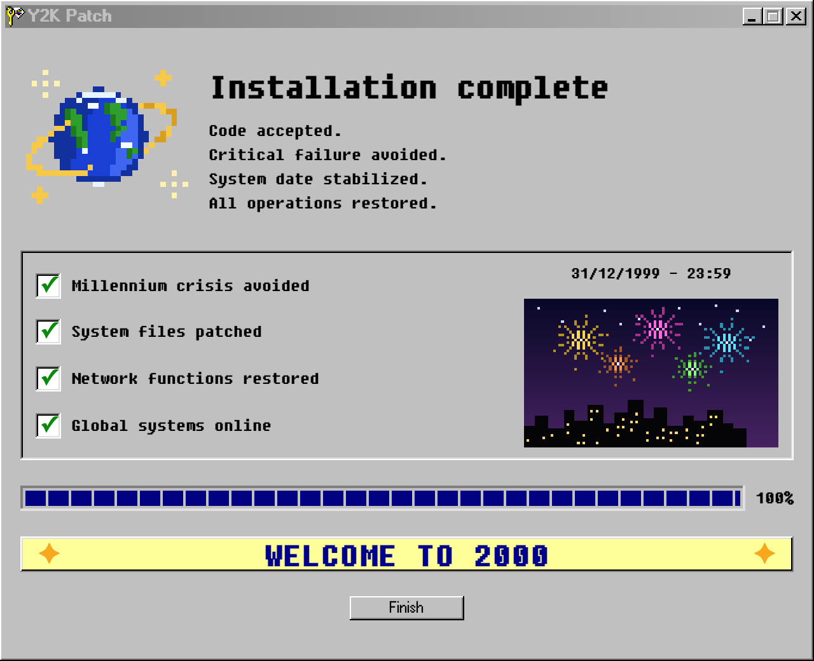

# Y2K Patch

## Purpose

The **Y2K Patch** window is where a team types the code recovered from the office game. A correct code confirms that the system was saved before midnight on December 31, 1999.

## Key Features

- **Desktop and Start menu entry**: A "Y2K Patch" shortcut on the desktop, restored for returning users, and an entry directly under Start > Programs.
- **One code per office**: Set by that office's admin in Improving CT October. Letter case, spaces, and dashes are ignored.
- **A live session**: This tab has to start a team in Improving CT October first. A reset team is told to contact the admin or start again.
- **Wrong code**: The window shows an error and the field stays editable. There is no lockout.
- **Success**: A short install sequence covers the desktop for two seconds and removes itself. The window then becomes a larger "Installation complete" screen — pixel-art globe, a four-item checklist beside a fireworks scene dated 31/12/1999 - 23:59, a 100% progress bar, a WELCOME TO 2000 banner, and a Finish button. The typed code is not shown. The same browser tab remembers the finish and does not play the sequence again; a team the server already finished sees the same screen.

## How to Use

1. Double-click **Y2K Patch** on the desktop, or open Start > Programs > Y2K Patch.
2. Type the recovered code and press Enter or click OK.

## Development

```bash
VITE_CT_API_URL=http://127.0.0.1:3001 bun run dev
```

The server decides whether the code is accepted. `code.js` only normalizes a code if a caller still needs that.

## Screenshot


